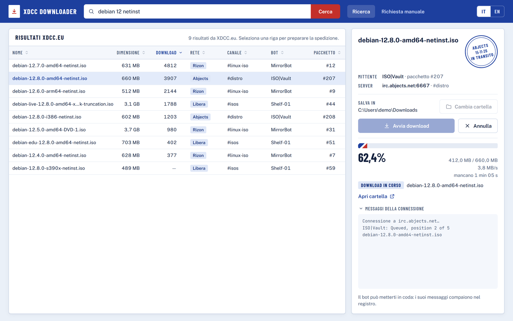

# XDCC Downloader

[English](README.md) · **Italiano**

Client Windows per scaricare file tramite XDCC, con Electron e [xdccJS](https://github.com/JiPaix/xdccJS) (MIT). Interfaccia in italiano e in inglese.



## Come funziona XDCC

Su IRC alcuni utenti automatici (i *bot*) offrono un elenco di file numerati, detti *pacchetti*. Per riceverne uno ci si collega al server IRC, si entra nel canale del bot e gli si scrive `xdcc send #numero`. Il bot risponde inviando il file con una connessione diretta (DCC).

Per scaricare servono quindi quattro dati: **server**, **canale**, **nome del bot** e **numero del pacchetto**. XDCC Downloader li ricava dalla ricerca o dal testo che incolli, poi esegue da solo tutti i passaggi.

## Installazione

Richiede Node.js e npm. Dalla cartella del progetto:

```powershell
npm install
npm start
```

Dopo l'installazione puoi avviare l'app anche con un doppio clic su `avvia.cmd`. La lingua segue quella di Windows; il selettore **IT / EN** in alto la cambia e la ricorda.

## Ricerca

Scrivi il nome di un file nella barra in alto, per esempio `debian netinst`, e premi **Cerca**. Ogni risultato mostra nome, dimensione, download, rete, canale, bot e pacchetto. Clicca una riga (o **Seleziona**): a destra, nel riquadro **Spedizione**, compaiono bot, server e canale. Scegli la cartella e premi **Avvia download**.

La tabella parte dai file più scaricati. Clicca l'intestazione di una colonna per ordinare; un secondo clic inverte l'ordine. Dimensioni e numeri vengono confrontati numericamente. Passa il mouse sui nomi troncati per leggerli per intero. I conteggi mancanti appaiono come `—` e restano in fondo.

La ricerca legge le pagine pubbliche di XDCC.eu senza eseguire i loro script, con una sola richiesta per ogni ricerca. Richiede Internet e può richiedere aggiornamenti se il sito cambia struttura. Una ricerca non avvia download né connessioni IRC, e i risultati non garantiscono che il bot sia disponibile.

## Richiesta manuale

Se conosci già i dati del pacchetto, apri la scheda **Richiesta manuale** e incollali. Mentre scrivi l'app controlla la richiesta e mostra il riepilogo della spedizione. Sono accettati due formati.

**Formato a campi**, quello che usano molti siti di ricerca XDCC:

```text
Server: irc.example.net
Channel: #linux-iso
Command: /msg MirrorBot xdcc send #12
```

**Link IRC più comando**, su due righe:

```text
irc://irc.example.net/linux-iso
/msg MirrorBot xdcc send #12
```

Entrambi dicono: collegati a `irc.example.net`, entra in `#linux-iso` e chiedi a `MirrorBot` il pacchetto 12.

Varianti riconosciute:

| Esempio | Significato |
|---|---|
| `irc://irc.example.net:7000/linux-iso` | porta diversa dalla 6667 predefinita |
| `ircs://irc.example.net/linux-iso` | connessione cifrata TLS (porta predefinita 6697) |
| `Server: ircs://irc.example.net:7000` | lo stesso, nel formato a campi |
| `/MSG MirrorBot XDCC SEND 12` | maiuscole e cancelletto facoltativi |
| `Channel: linux-iso` | il `#` del canale si può omettere |

## Durante il download

Non parte alcuna richiesta fino al clic su **Avvia download**. Il timbro del riquadro **Spedizione** e l'etichetta di stato dicono a che punto sei: in partenza, in coda dal bot, in transito, consegnato o respinto. La barra a righe della posta aerea è proporzionale ai byte ricevuti; sotto ci sono velocità e tempo rimanente. **Messaggi della connessione** mostra i passaggi e i messaggi del bot, per esempio la posizione in coda. **Annulla** chiude la connessione e conserva gli eventuali file parziali; la ripresa è gestita da xdccJS.

## Limiti

Il funzionamento con un bot reale dipende dalla rete, dalla disponibilità del bot e dalle sue regole. Il rilevamento delle code usa espressioni comuni inglesi e italiane; messaggi diversi possono richiedere un adattamento. Non aprire contemporaneamente più istanze sullo stesso file.

## Uso responsabile

XDCC Downloader è un client, come qualunque programma IRC: non ospita, non indicizza e non distribuisce nulla. Chiede a un bot un file che il bot offre pubblicamente, e solo quando premi **Avvia download**.

- **Diritto d'autore e leggi sono una tua responsabilità.** Scarica solo ciò che hai il diritto di ottenere: software libero, distribuzioni Linux, opere di pubblico dominio, contenuti con licenze libere o file tuoi. Le leggi cambiano da paese a paese: verifica quelle che valgono per te.
- **Rispetta le reti e i bot.** Ogni rete IRC e ogni canale ha le sue regole: alcune chiedono un nick registrato, limitano i download o vietano i client automatici. Leggile e rispettale. L'app esegue un download alla volta, attende nella coda del bot e non ritenta da sola, per non caricare i server.
- **Rispetta il servizio di ricerca.** La ricerca legge le pagine pubbliche di XDCC.eu con una sola richiesta per ricerca e un nome di client riconoscibile. Usala nel rispetto delle condizioni del sito; non usare l'app per scaricarne i dati in massa.
- **Nessuna affiliazione.** Il progetto è indipendente e non è affiliato a XDCC.eu, a xdccJS né ad alcuna rete IRC.
- **Nessuna garanzia.** Il software è fornito "così com'è", con licenza [MIT](LICENSE).

## Suggerimenti e segnalazioni

I suggerimenti sono ben accetti. Apri una [issue](https://github.com/b4p3p/xdcc-downloader/issues) per un'idea, un bug o una domanda: descrivi cosa hai provato e cosa ti aspettavi, e per i bug allega il testo di **Messaggi della connessione** (togliendo ciò che è privato). Anche le pull request sono benvenute: prima leggi [AGENTS.md](AGENTS.md).

## Sviluppo

- `npm test` verifica il riconoscimento delle richieste, la lettura dei risultati di ricerca e un trasferimento DCC tramite un server IRC locale, inclusa l'interruzione prima del completamento.
- `npm run smoke` apre l'interfaccia e prova ricerca, selezione e ordinamento con dati finti.
- `npm run shots` cattura le schermate degli stati principali in `.impeccable/review/`.
- `npm run pack` genera un installer Windows e un eseguibile portable in `dist`; `npm run pack:check` lo verifica.

Le istruzioni per chi contribuisce (anche agenti) sono in [AGENTS.md](AGENTS.md).

## Licenza

[MIT](LICENSE). I font inclusi (Public Sans, Barlow Condensed) sono distribuiti con licenza SIL Open Font License 1.1, vedi `src/assets/fonts/`.
