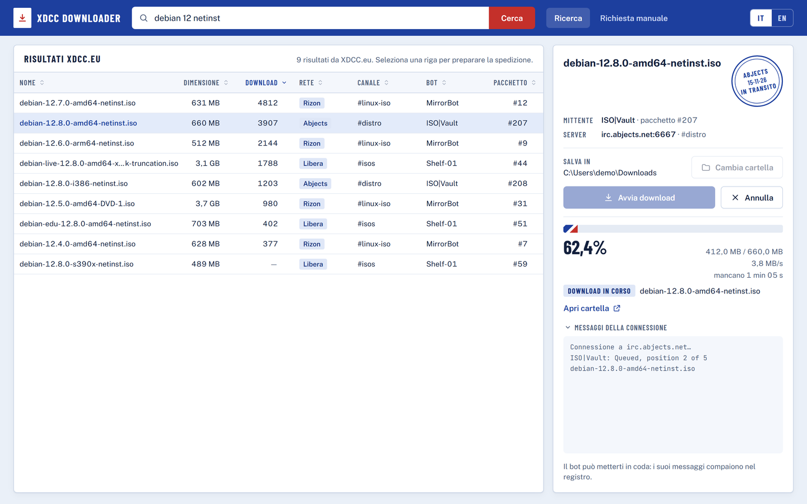

# XDCC Downloader

**English** · [Italiano](README.it.md)

A Windows client for downloading files over XDCC, built with Electron and [xdccJS](https://github.com/JiPaix/xdccJS) (MIT). The interface is available in English and Italian.



## How XDCC works

On IRC some automated users (*bots*) offer a list of numbered files, called *packs*. To get one you connect to the IRC server, join the bot's channel and send it `xdcc send #number`. The bot replies by sending the file over a direct connection (DCC).

A download therefore needs four pieces of data: **server**, **channel**, **bot name** and **pack number**. XDCC Downloader takes them from a search or from the text you paste, then performs every step by itself.

## Installation

Requires Node.js and npm. From the project folder:

```powershell
npm install
npm start
```

After installing you can also start the app by double-clicking `avvia.cmd`. The language follows Windows; the **IT / EN** switch at the top changes it and remembers your choice.

## Search

Type a file name in the bar at the top, for example `debian netinst`, and press **Search**. Each result shows name, size, downloads, network, channel, bot and pack. Click a row (or **Select**): the bot, server and channel appear on the right, in the **Shipment** panel. Choose the folder and press **Start download**.

The table starts with the most downloaded files. Click a column header to sort; a second click reverses the order. Sizes and numbers are compared numerically. Hover over truncated names to read them in full. Missing counts show as `—` and stay at the bottom.

Search reads the public pages of XDCC.eu without running their scripts, with a single request per search. It needs Internet access and may need updates if the site changes its structure. A search never starts downloads or IRC connections, and results do not guarantee that the bot is online.

## Manual request

If you already know the pack details, open the **Manual request** tab and paste them. The app checks the request as you type and shows the shipment summary. Two formats are accepted.

**Field format**, used by many XDCC search sites:

```text
Server: irc.example.net
Channel: #linux-iso
Command: /msg MirrorBot xdcc send #12
```

**IRC link plus command**, on two lines:

```text
irc://irc.example.net/linux-iso
/msg MirrorBot xdcc send #12
```

Both mean: connect to `irc.example.net`, join `#linux-iso` and ask `MirrorBot` for pack 12.

Recognised variants:

| Example | Meaning |
|---|---|
| `irc://irc.example.net:7000/linux-iso` | port other than the default 6667 |
| `ircs://irc.example.net/linux-iso` | TLS encrypted connection (default port 6697) |
| `Server: ircs://irc.example.net:7000` | the same, in field format |
| `/MSG MirrorBot XDCC SEND 12` | case and the hash sign are optional |
| `Channel: linux-iso` | the channel `#` can be omitted |

## During the download

Nothing is sent until you click **Start download**. The postmark in the **Shipment** panel and the state label tell you where things stand: departing, queued by the bot, in transit, delivered or returned. The airmail-striped bar is proportional to the bytes received, with speed and time left below it. **Connection messages** shows each step and the bot's messages, such as your queue position. **Cancel** closes the connection and keeps any partial file; resuming is handled by xdccJS.

## Limits

Working with a real bot depends on the network, on the bot's availability and on its rules. Queue detection uses common English and Italian phrases; other wording may need an adjustment. Do not run several instances on the same file at once.

## Responsible use

XDCC Downloader is a client, like any IRC program: it hosts, indexes and distributes nothing. It only asks a bot for a file that the bot offers publicly, and only when you press **Start download**.

- **Copyright and the law are your responsibility.** Download only what you have the right to obtain: free software, Linux distributions, public domain works, content under free licences or your own files. Laws differ from country to country: check the ones that apply to you.
- **Respect the networks and the bots.** Every IRC network and every channel has its own rules: some require a registered nickname, limit downloads or forbid automated clients. Read them and follow them. The app runs one download at a time, waits in the bot's queue and does not retry on its own, so as not to load the servers.
- **Respect the search service.** Search reads the public pages of XDCC.eu with one request per search and an identified client name. Use it in line with the site's terms; do not use the app to scrape it in bulk.
- **No affiliation.** The project is independent and is not affiliated with XDCC.eu, with xdccJS or with any IRC network.
- **No warranty.** The software is provided "as is", under the [MIT](LICENSE) licence.

## Suggestions and bug reports

Suggestions are very welcome. Open an [issue](https://github.com/b4p3p/xdcc-downloader/issues) for an idea, a bug or a question: describe what you tried and what you expected, and for bugs attach the text of **Connection messages** (remove anything private). Pull requests are welcome too: read [AGENTS.md](AGENTS.md) first.

## Development

- `npm test` checks request parsing, search result parsing and a DCC transfer through a local IRC server, including a transfer cut short before completion.
- `npm run smoke` opens the interface and exercises search, selection and sorting with fake data.
- `npm run shots` captures the main states into `.impeccable/review/`.
- `npm run pack` builds a Windows installer and a portable executable in `dist`; `npm run pack:check` verifies it.

Contributor (and coding agent) guidelines are in [AGENTS.md](AGENTS.md).

## License

[MIT](LICENSE). The bundled fonts (Public Sans, Barlow Condensed) are distributed under the SIL Open Font License 1.1, see `src/assets/fonts/`.
